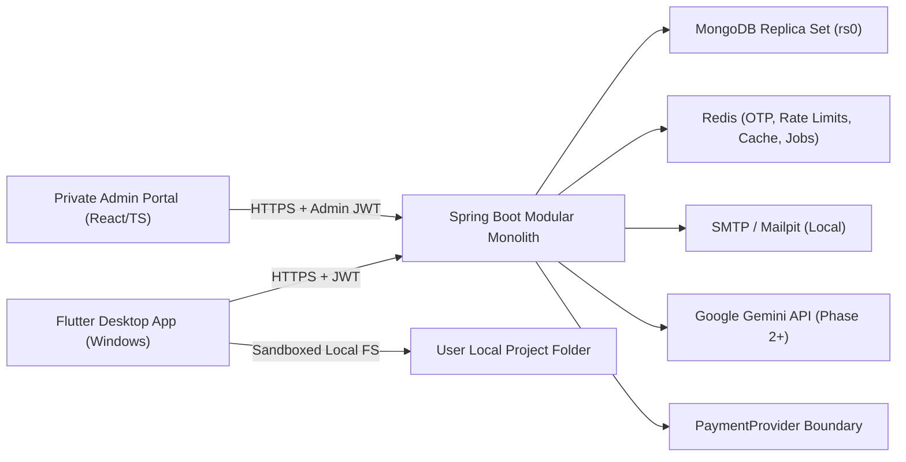

# Rmap System Architecture & Module Map

## 1. High-Level Architecture



## 2. Backend Module Map (`backend/src/main/java/com/rmap/platform`)

Rmap's backend is a **modular monolith** with strict package boundaries so engines can evolve cleanly across Phases 1–4.

| Module Package | Phase | Responsibility |
| :--- | :---: | :--- |
| `common` | 1 | `ApiResponse<T>`, global `ProblemDetail` exception handler, audit model, clock/UUID helpers, OpenAPI config |
| `config` | 1 | SecurityFilterChain, CORS, JWT properties, Redis/MongoDB config, Actuator health |
| `auth` | 1 | Registration, Email OTP generation/verification (Redis + Mailpit/SMTP), login, logout, password reset, JWT access token + rotating refresh token |
| `user` | 1 | User entity, roles (`USER`, `ADMIN`), profile management, account status |
| `billing` | 1 | 72-hour trial provisioning, subscription plans, `EntitlementService`, read-only enforcement, `PaymentProvider` abstraction, webhook verification & idempotency |
| `workspace` | 1 | Local workspace registration metadata (no raw filesystem access from cloud), permission profiles, safe-boundary policy snapshots |
| `admin` | 1 | Backend-authorized admin endpoints: users, trials, subscriptions, payment history, audit logs, email logs, system health |
| `project` | 2 | Project CRUD, modes, types, `ProjectSpec` versioning, traceability |
| `document` | 2 | Untrusted document ingestion, parsing, chunking, source-page citations |
| `ai` | 2 | `LlmProvider` (Google Gemini), 4 internal AI agents, persistent workflow orchestrator, usage/cost ledger |
| `verification` | 3 | Requirement state machine, repository evidence ingestion, error analysis |
| `delivery` | 3 | Documentation exports, deployment guides, academic deliverable packs |

## 3. Desktop Application Module Map (`desktop/lib`)

```text
desktop/lib/
  main.dart
  app.dart
  core/
    config/         # API base URL, environment config
    network/        # Centralized Dio ApiClient, JWT/refresh interceptor, typed errors
    routing/        # go_router configuration & auth/entitlement guards
    storage/        # Secure token storage + local preferences
    theme/          # Centralized design tokens, light/dark/system ThemeData
    navigation/     # Data-driven navigation registry (WORKSPACE, DISCOVERY, DESIGN, ENGINEERING, QUALITY, DELIVERY, PROJECT-SPECIFIC, ACCOUNT)
  features/
    auth/           # Login, Register, Email OTP verification, Password Reset, Session controller
    shell/          # Main desktop layout: collapsible sidebar, workspace, resizable AI panel, command palette, status bar
    dashboard/      # Workspace overview, entitlement/trial banner, quick actions
    workspace/      # Secure local workspace picker, path boundary validator, sensitive-file filter, read-only scanner
    billing/        # Trial status, plan overview, read-only entitlement notice
    settings/       # Theme switcher, API endpoint config, profile, account & security
    placeholders/   # Phase 2/3 feature views clearly marked as scheduled roadmap modules
```

## 4. Private Admin Portal Module Map (`admin/src`)

```text
admin/src/
  api/              # Centralized typed fetch client with Admin JWT auth
  auth/             # Admin auth context & protected route guard
  components/       # Shared sidebar layout, data tables, status badges
  pages/            # Login, Overview/Health, Users, Subscriptions & Trials, Billing/Payments, Audit & Email Logs
  types/            # Strict TypeScript domain models matching backend DTOs
```

## 5. Phase 1 Implementation Plan

1. **Checkpoint A — Monorepo & Infrastructure**: Directory skeleton, `.gitignore`, `infra/docker-compose.yml` (MongoDB `rs0`, Redis, Mailpit), `infra/.env.example`, replica set init script, root docs & Antigravity rules.
2. **Checkpoint B — Spring Boot Backend Foundation**: Maven Wrapper (`mvnw`), Spring Boot 3.4.5 (Java 21 target), modular package structure, `ApiResponse`, `GlobalExceptionHandler`, Actuator health, OpenAPI.
3. **Checkpoint C — MongoDB Replica Set, Redis & Mailpit**: MongoDB auditing & indexes, Redis template & OTP/rate-limit store, `EmailService` with Mailpit/SMTP delivery + persistent `EmailDeliveryLog`.
4. **Checkpoint D — Flutter Windows Desktop & Design System**: Windows-first Flutter app, centralized neutral design tokens (Linear/VS Code style), light/dark/system themes, collapsible sidebar, resizable right AI panel, project selector, command palette (`Ctrl+K`), status bar, data-driven navigation registry.
5. **Checkpoint E — Authentication & Email OTP**: Register, Email OTP verify/resend, Login, Logout, Refresh token rotation with reuse detection, Password reset via OTP, Profile endpoint, and Desktop Auth UI flows.
6. **Checkpoint F — Trial, Subscription & Billing Foundation**: Automatic 72-hour trial on verification, subscription plans catalog, `EntitlementService` (ACTIVE_TRIAL, ACTIVE_PAID, READ_ONLY_EXPIRED), backend read-only guard annotation, `PaymentProvider` interface + `UnconfiguredPaymentProvider` + HMAC webhook verification boundary.
7. **Checkpoint G — Secure Local Workspace Selection**: Desktop folder picker (`file_selector`), canonical path boundary guard, sensitive-file denylist (`.env`, `*.pem`, `*.key`, etc.), read-only bounded file/stack scanner, workspace metadata sync with backend.
8. **Checkpoint H — Private Admin Portal Foundation**: React + TypeScript + Vite app, Admin login, system health dashboard, user management, trial/subscription override actions, payment/audit/email log views.
9. **Checkpoint I — Integration Tests, Build Verification & CI**: Backend unit/WebMvc tests, Flutter analyze + widget/unit tests + Windows debug build, Admin typecheck + Vitest + production build, GitHub Actions CI workflow, and `docs/phase-reports/phase-1.md`.
